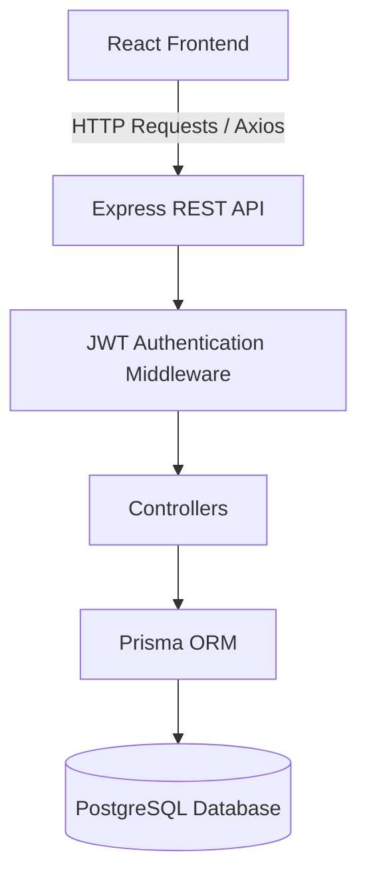

# Ajaia Docs — System Architecture

## 1. Overview

Ajaia Docs follows a client-server architecture. The frontend communicates with a REST API built using Express.js. The backend handles authentication, document management, sharing permissions, and database operations.

## 2. Architecture Diagram

## 3. Technology Layers

### Frontend Layer

Built with React and Vite.

Responsibilities:
- User registration and login
- Document dashboard
- Rich-text document editor using Tiptap
- Document creation, renaming, and deletion
- Text file import
- Document sharing interface
- Displaying document access permissions

Axios is used to communicate with the backend API. JWT tokens are attached to authenticated requests.

### Backend Layer

Built with Node.js and Express.js.

Responsibilities:
- Authentication and authorization
- Document CRUD operations
- Document sharing management
- Input validation
- Access permission verification
- Database communication

The backend follows a route-controller structure to keep API handling organized.

### Database Layer

PostgreSQL is used for persistent storage, with Prisma ORM for database operations.

The main database models are:

**User**
- id
- name
- email
- password
- createdAt

**Document**
- id
- title
- content
- ownerId
- createdAt
- updatedAt

**DocumentShare**
- id
- documentId
- userId
- permission
- createdAt

Document content is stored as JSON using the Tiptap document structure.

## 4. Authentication Flow

1. A user registers with their name, email, and password.
2. The backend hashes the password using bcrypt.
3. During login, the backend verifies the credentials.
4. A JWT token is generated after successful authentication.
5. The frontend stores the token and attaches it to protected API requests.
6. JWT middleware verifies the token before allowing access to protected routes.

## 5. Document Management Flow

1. An authenticated user creates a document.
2. The backend assigns the user as the document owner.
3. The document is stored in PostgreSQL.
4. The frontend retrieves accessible documents from the API.
5. The user edits document content through Tiptap.
6. Changes are automatically saved through the update API.
7. The document can be reopened later with its saved content.

## 6. Document Sharing and Permissions

A separate `DocumentShare` model manages document access.

Supported permissions:

| Role | View | Edit | Delete | Manage Sharing |
|---|---|---|---|---|
| Owner | Yes | Yes | Yes | Yes |
| Editor | Yes | Yes | No | No |
| Viewer | Yes | No | No | No |

The backend checks document ownership or sharing permissions before allowing access or updates.

Only the document owner can manage sharing permissions and delete the document.

## 7. File Import

The application supports importing `.txt` files.

1. The user selects a text file.
2. The frontend reads its content.
3. Text is converted into paragraphs compatible with Tiptap.
4. The imported content is saved through the document update API.

## 8. Data Relationships

- One user can own multiple documents.
- One document belongs to one owner.
- A document can be shared with multiple users.
- A user can access multiple shared documents.
- Each document-user sharing relationship has one permission level.

## 9. Error Handling and Validation

The backend validates document update requests and checks access permissions before modifying data.

HTTP status codes are used to communicate errors, including:
- `400` — Invalid request data
- `401` — Authentication required or invalid token
- `404` — Document not found or access denied
- `500` — Internal server error

## 10. Current Scope and Limitations

- Real-time collaborative editing is not implemented.
- Text file import currently supports `.txt`.
- Sharing is available to registered users.
- Document updates are persisted through the REST API.

